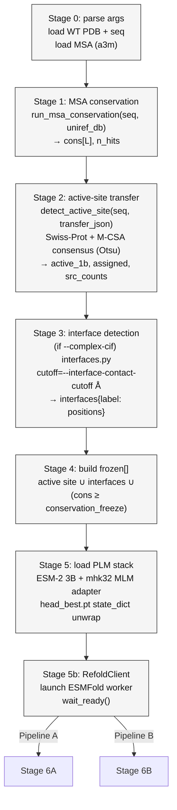
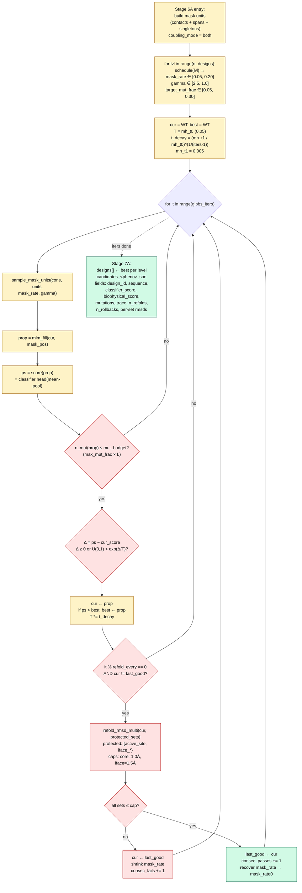
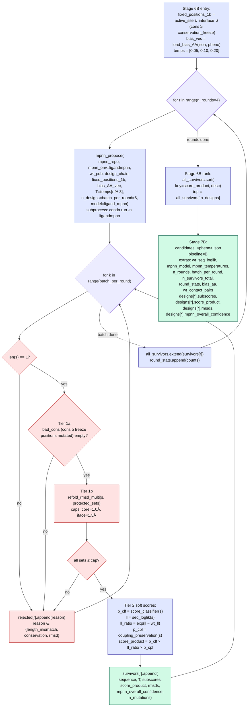
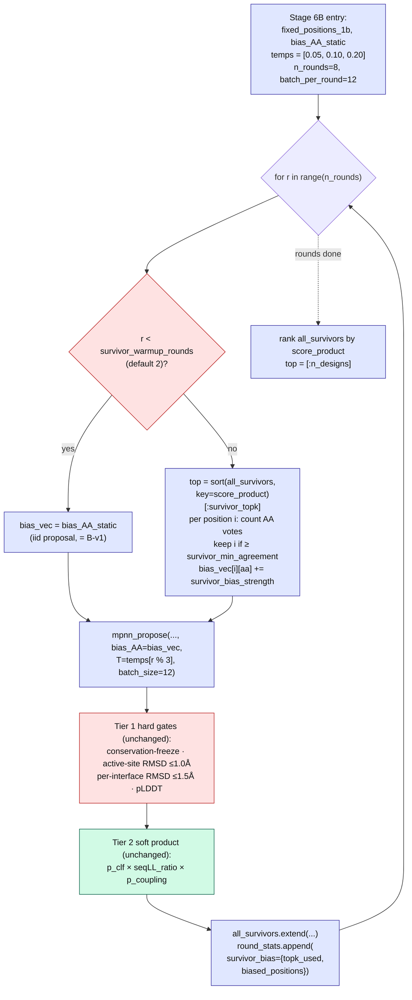

# Generation pipeline architecture — A vs B

Head-to-head diagrams of the two generative pipelines that share Stages 0–5 and
diverge at Stage 6 (design loop). Both target IS621 (8WT6 chain A, 306 aa) and
consume the same mhk32 adapter + per-phenotype `head_best.pt` classifier.

- **Pipeline A** — `scripts/11_generate.py`: MLM-in-the-loop Gibbs+MH sampler
  with periodic refold + RMSD rollback (single hard fold gate; classifier score
  is the acceptance signal).
- **Pipeline B** — `scripts/11_generate_pipelineB.py`: LigandMPNN-in-the-loop
  proposer with per-round temperatures, per-candidate refold + RMSD hard gate,
  and a multiplicative soft score (classifier × seqLL ratio × coupling).

Companion sbatch wrappers:
`scripts/slurm/11_generate_is621.sbatch` (A) and
`scripts/slurm/11_generate_is621_pipelineB.sbatch` (B), both `time=48:00:00`.

---

## Shared front matter (Stages 0–5)

Notes:
- Conservation threshold defaults to 0.90 in both pipelines
  (`--conservation-freeze 0.90`).
- Active-site RMSD cap = `--core-rmsd-cap` (default 1.0 Å in both).
- Interface RMSD cap = `--interface-rmsd-cap` (default 1.5 Å in both).
- `head_best.pt` load path unwraps the checkpoint dict (`state_dict` key) —
  fix applied in both scripts (2026-08-19).

---

## Pipeline A — Gibbs + Metropolis-Hastings

`scripts/11_generate.py` — MLM-in-the-loop proposer, contact/span-coupled
masking, classifier-score acceptance with periodic refold rollback.

**Key parameters (defaults):**
- `--n-designs 3` (aggressiveness levels)
- `--gibbs-iters 24`
- `--mh-t0 0.05 --mh-t1 0.005` (geometric anneal per level)
- `--refold-every 4`
- `--mask-rate` schedule 0.05 → 0.20 across levels
- `--max-mut-frac 0.30` (hard cap on residues changed)
- `coupling_mode=both` — contact-pair + span-length units

**Acceptance geometry:** score is directional (classifier alone), fold is
gated periodically (every 4 iters); a run can *end below its peak* under MH,
so `best` is tracked separately and returned as the design.

---

## Pipeline B-v1 — MPNN-in-the-loop with hard/soft two-tier gate

> **Scope note (added 2026-10-12).** This section describes **B-v1**, the
> *iid* form: every round draws from the same static `bias_AA` vector and
> rounds are independent. The production benchmark used **B-v2**
> (survivor-conditioned, feature commit `8cf4f97`), diagrammed in the next
> section. Both are the same file — `11_generate_pipelineB.py` — and the
> on-disk **defaults reproduce v1**; v2 is reached only by passing
> `--survivor-topk > 0` (the sbatch wrapper sets it from `GEN_B_*` env vars).

`scripts/11_generate_pipelineB.py` — LigandMPNN proposer over `n_rounds`
rounds at cycling temperatures, per-candidate refold + RMSD *hard* gate,
then a multiplicative *soft* score product for ranking.

**Key parameters (defaults):**
- `--n-rounds 4 --batch-per-round 6` → up to 24 candidates/run
- `--temperatures 0.05,0.10,0.20` (cycled by round mod len)
- `--n-designs 3` (top-K after ranking survivors)
- `--conservation-freeze 0.90`
- `--core-rmsd-cap 1.0 --interface-rmsd-cap 1.5`
- `--mpnn-model ligand_mpnn` (LigandMPNN v1)
- `--bias-aa-json data/bias_aa_by_phenotype.json`

**Acceptance geometry:** every proposal is folded and gated (no periodic
skipping), and the ranker is *intended* to be a product of three sub-scores,
so that a design must be plausible under the classifier, close to WT under
the language model, AND preserve WT contact patterns to rank at all.

> **Correction (2026-10-12) — the coupling factor was inert in production.**
> In all four production B-v2 runs `wt_contact_pairs = 0`, because
> `_predict_contacts` raised `IndexError: tuple index out of range` and the
> oracle took its documented fallback:
> `[11B-oracle] WARN wt contact map failed (IndexError: tuple index out of
> range); coupling term set to 1.0 for every design`.
> Consequently `p_coupling = 1.0` for **every** design of **every**
> phenotype, and the "preserve WT contact patterns" clause above was never
> enforced. With `seqLL_ratio` also confined to 0.6805–0.7126 across all 12
> ranked designs, the production ranking reduces in practice to
> `score_product ≈ 0.70 × p_classifier` — a one-factor ranker.
> Structural fidelity *was* still enforced, but by the Tier-1 RMSD gate, not
> by this term. Fix `_predict_contacts` before quoting `score_product` as a
> composite.

---

## Pipeline B-v2 — survivor-conditioned MPNN (production)

`scripts/11_generate_pipelineB.py` with `--survivor-topk > 0`. Identical
Tier-1/Tier-2 machinery to B-v1; the difference is that after a warmup of
`--survivor-warmup-rounds` iid rounds, the top-K survivors *so far* vote on
a per-residue amino-acid bias that is added to the static `bias_AA` for the
next round. This turns B from an iid sampler into a hill-climb.

**Production parameters** (`11_generate_is621_pipelineB_v2.sbatch`, via env):

| Flag | Env var | Production value |
|---|---|---|
| `--n-rounds` | `GEN_B_ROUNDS` | 8 |
| `--batch-per-round` | `GEN_B_BATCH` | 12 |
| `--survivor-topk` | `GEN_B_SURVIVOR_TOPK` | 8 |
| `--survivor-min-agreement` | `GEN_B_SURVIVOR_MIN_AGREE` | 6 |
| `--survivor-bias-strength` | `GEN_B_SURVIVOR_BIAS_STRENGTH` | 5.0 |
| `--survivor-warmup-rounds` | `GEN_B_SURVIVOR_WARMUP` | 2 |

Budget: 8 × 12 = 96 proposals/run vs v1's 4 × 6 = 24.

**Observed behaviour (2026-08-19 production runs).** Bias saturates: by
round 7, `biased_positions` reaches 94/99/97/93 of 306 for
halophile/hyperthermophile/thermophile/alkaliphile, with `topk_used=8` at
every biased round — the intended hill-climb signature.

**Known failure mode — the bias can break the Tier-1 gate.** For
alkaliphile, rounds 2–7 returned **zero** survivors (86 rejections, all
`rmsd`); all 10 retained survivors came from the two iid warmup rounds, and
all three reported designs carry `round ∈ {0, 1}`. The alkaliphile "B-v2"
result is therefore a **B-v1-equivalent** draw, not a survivor-conditioned
one. If a run shows `survivors=0` from the first biased round onward, lower
`--survivor-bias-strength` or raise `--survivor-min-agreement` before
trusting the output as v2.

---

## What changed vs `docs/generation_pipeline.md`

The older `generation_pipeline.md` predates the mhk32 adapter refactor and
describes MPNN as an out-of-loop gate on top of Gibbs. This document reflects
the current scripts:

| Aspect | Old doc | Pipeline A (now) | Pipeline B-v1 | Pipeline B-v2 |
|---|---|---|---|---|
| Proposer | ESM-2 + adapter | ESM-2 + mhk32 adapter | LigandMPNN (subprocess) | LigandMPNN (subprocess) |
| Acceptance | classifier score | classifier + MH anneal | product (clf × llR × cpl) | product (clf × llR × cpl) |
| Fold gate | out-of-loop MPNN + refold | in-loop refold every 4 iters | in-loop refold per candidate | in-loop refold per candidate |
| Rollback | discard-only | shrink mask_rate + revert | reject-only (no revert) | reject-only (no revert) |
| Composition bias | – | – | static per-phenotype bias_AA | static bias_AA **+ survivor-voted per-residue bias** |
| Round coupling | – | sequential MH chain | rounds iid | rounds conditioned on survivors so far |
| Budget | – | 24 iters × 3 levels | 4 × 6 = 24 proposals | 8 × 12 = 96 proposals |
| Interfaces | active-site only | active + per-interface RMSD | active + per-interface RMSD | active + per-interface RMSD |

**Where the adapter acts.** The mhk32 LoRA adapter is **not** a conditioning
input to LigandMPNN — MPNN is structure-conditioned and never sees ESM. The
adapter enters only through the Tier-2 oracle (`p_classifier` via the
mean-pooled head, and `seqLL_ratio`). In B-v1 that makes it a pure post-hoc
*filter*. In B-v2 it closes the loop: survivors are ranked by the
adapter-derived `score_product`, and those survivors write the per-residue
bias for the next round — so the adapter steers proposals **indirectly**,
one round late. The static `bias_AA` vector is independent of the adapter;
it is a corpus statistic, `log(freq_ext_aa / freq_meso_aa)` computed by
`scripts/prep_bias_aa.py` over the labeled dataset.

## Progress monitoring rubric (all 4+4 jobs, 48 h walltime)

- Pipeline A logs: `is621_gen_<JOBID>.log`, line format
  `[gen] iter=<i>/24 accept=<n> ...` — expect ~24 iters × 3 levels per pheno.
- Pipeline B-v1 logs: `is621_genB_<JOBID>.log`, line format
  `[genB] === round <r>/4 batch=6 T=<T> ===` — expect 4 rounds × 6 candidates.
- Pipeline B-v2 logs: `is621_genBv2_<JOBID>.log` — expect 8 rounds × 12
  candidates. Watch `survivor_bias={'topk_used':…, 'biased_positions':…}` in
  `round_stats`: `topk_used` should reach `--survivor-topk` and
  `biased_positions` should climb from round `--survivor-warmup-rounds`
  onward. **If `survivors` drops to 0 at the first biased round and stays
  there, the bias is breaking the Tier-1 RMSD gate** — the run degenerates to
  a warmup-only (B-v1-equivalent) draw. This happened to alkaliphile on
  2026-08-19.
- Also grep for `[11B-oracle] WARN wt contact map failed`. If present,
  `p_coupling` is 1.0 for every design and `score_product` is not a
  three-factor composite.
- `squeue -u $USER -o '%.10i %.16j %.10L'` for remaining walltime.
- If a first Pipeline A iter > 20 min or a first Pipeline B round > 30 min,
  48 h may still be tight; log the rate and check back at ~1 h.

## `biophysical_score` semantics — read before comparing values

`biophysical_score` (`11_generate.py:174`) is an **absolute composition
statistic of the design alone**. It is *not* a delta versus WT, *not*
normalised, and *not* comparable across phenotypes — each phenotype uses a
different formula on different units:

| phenotype | formula | range | WT-relative? |
|---|---|---|---|
| thermophile / hyperthermophile | `f(IVYWREL) + 0.5·f(DEKR)` | [0, 1.5] | no |
| halophile | `f(D)+f(E)` | [0, 1] | no |
| acidophile | `f(D)+f(E) − f(K)−f(R)` | [−1, 1] | no |
| alkaliphile | `f(K)+f(R) − f(D)−f(E)` | [−1, 1] | no |
| *(default)* | `f(DEKR)` | [0, 1] | no |

`f(X)` = fraction of residues in set X. Consequences:

- **A negative alkaliphile/acidophile value is not a failure flag.** It
  means the design has more acidic than basic residues. Most proteins do.
  Judge it against the WT's own value, not against zero.
- **Cross-phenotype comparison is meaningless.** thermophile 0.63 and
  halophile 0.18 are different statistics; 0.18 D+E is in fact a *high*
  acidic fraction (typical proteins ≈ 0.12).
- **It says nothing about function or stability.** It is a composition
  proxy, explicitly labelled a "non-learnable anti-gaming layer". Function
  is protected by the Tier-1 gates (active-site RMSD, per-interface RMSD,
  conservation freeze), not by this number.
- **It does not gate anything in either pipeline.** Despite
  `generation_pipeline.md` §Stage-6 describing the objective as "the learned
  score *gated by* biophysical agreement", neither `11_generate.py` (A) nor
  `11_generate_pipelineB.py` (B) uses it in acceptance or ranking. In A the
  acceptance variable is the classifier score alone; in B the ranker is
  `p_clf × seqLL_ratio × p_coupling`. In both it is computed once at write
  time and reported. *(Divergence recorded 2026-10-12; `generation_pipeline.md`
  is the stale document.)*

## Historical job IDs (2026-08-19 production run)

> These IDs are a record of the 2026-08-19 submission, not a live queue
> state. The runs they refer to are complete; outputs are under
> `eptrans_scratch/gen/is621*_20260818_*` and `is621Bv2_20260819_*`.

| Job | Script | Phenotype |
|---|---|---|
| 1178426 | 11_generate.py (A) | thermophile |
| 1178427 | 11_generate.py (A) | halophile |
| 1178428 | 11_generate.py (A) | hyperthermophile |
| 1178429 | 11_generate.py (A) | alkaliphile |
| 1178430 | 11_generate_pipelineB.py (B) | thermophile |
| 1178431 | 11_generate_pipelineB.py (B) | halophile |
| 1178432 | 11_generate_pipelineB.py (B) | hyperthermophile |
| 1178433 | 11_generate_pipelineB.py (B) | alkaliphile |

All 8 running on `gpu_h200 node-224-2t-8gpu-1` at 48 h walltime.
